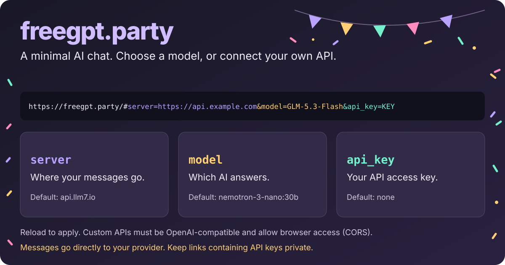

# freegpt.party



A minimal browser-based AI chat, based on [tinygrad's chat interface](https://github.com/tinygrad/tinygrad/blob/master/tinygrad/llm/chat.html).

## Use it

1. Open [freegpt.party](https://freegpt.party).
2. Choose a model from the dropdown.
3. Type a message and press **Enter** to send. Use **Shift+Enter** for a new line.
4. Wait for the response to finish before sending another message.

Refresh the page to start a new conversation. Chat history lives only in the page's memory and is lost on refresh.

With no fragment, the app adds `#server=https://api.llm7.io&model=nemotron-3-nano:30b&api_key=` to the URL. Existing fragments are left untouched: omitting `server` uses the page's own origin, and omitting `model` selects the first available model. Available models, rate limits, and service availability depend on the API provider.

## Use another model or API server

Configure the app with URL fragment parameters (after `#`, not `?`):

| Parameter | Purpose |
| --- | --- |
| `server` | API base URL, without `/v1`. Trailing slashes are stripped. |
| `model` | Model ID to select from the server's model list. |
| `api_key` | Optional API key, sent to the server as a Bearer token. |

For example, select a model:

```text
https://freegpt.party/#server=https://api.llm7.io&model=GLM-5.3-Flash
```

Or connect to your own API (replace the example values):

```text
https://freegpt.party/#server=https%3A%2F%2Fapi.example.com&model=your-model&api_key=your-key
```

URL-encode parameter values, especially keys containing `&`, `+`, or `#`. Reload the page after changing parameters.

The server must support OpenAI-compatible `GET /v1/models` and streaming `POST /v1/chat/completions`. Requests go directly from your browser, so the server must allow cross-origin requests (CORS) from the site's origin, including any required headers. Use HTTPS when connecting from the hosted site.

## Privacy

- Your messages and conversation context are sent to the selected API provider. Its data retention and privacy policies apply.
- The site is a static frontend, not an API proxy. Markdown JavaScript is hosted alongside the page rather than fetched from a third-party CDN.
- URL fragments are not sent to the static hosting server, but keys in URLs can remain in browser history or be exposed when sharing links. Don't share URLs containing API keys; use restricted, disposable keys where possible.

## Contributing

Low line count, extremely tasteful PRs may be merged.

After editing `docs/freegpt-party.svg`, run `npm run render:card` to regenerate `public/social-card.png`. Requires Python 3 with Pillow, `rsvg-convert` (librsvg), and Noto Sans ExtraBold. Commit both the SVG and PNG; rendering isn't part of deployment.
